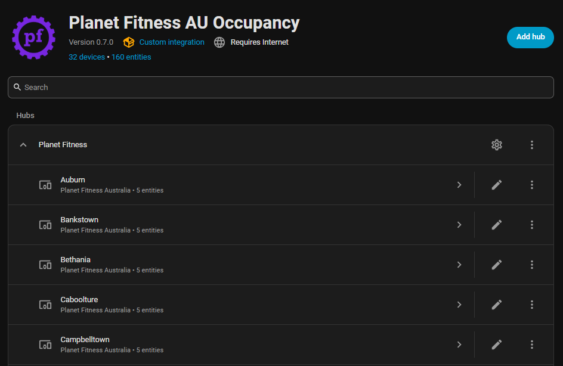
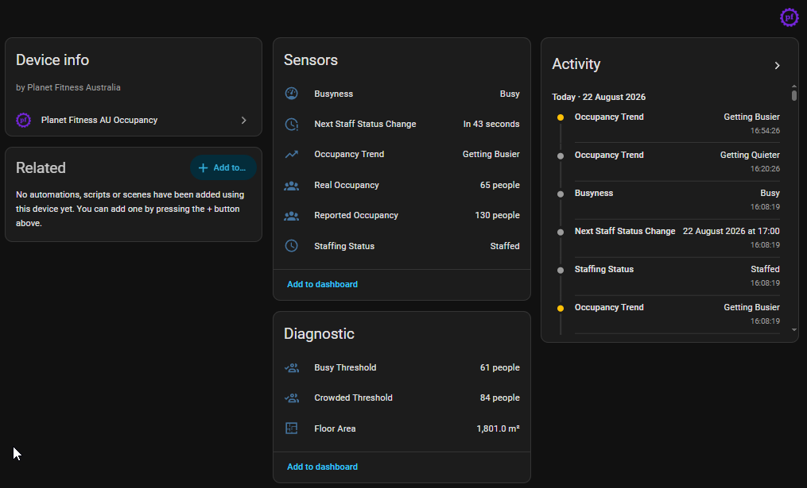
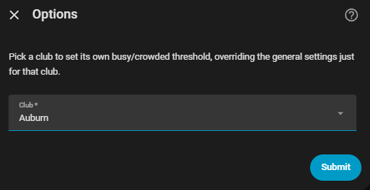
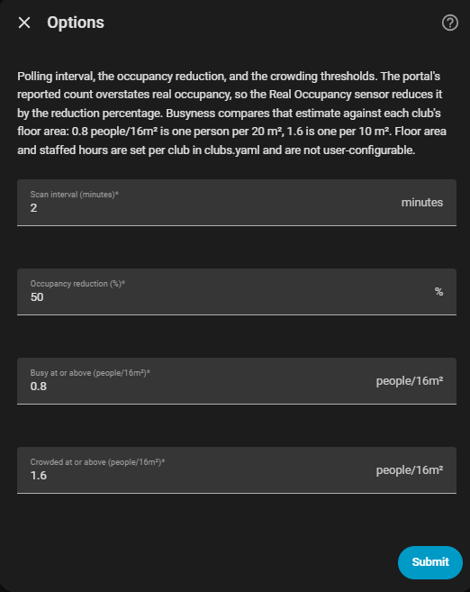

<div align="center">


# Planet Fitness AU Occupancy

Live occupancy, crowding, staffing and trend sensors for every Planet Fitness Australia club.

<br>

[![Release][release-badge]][release-url]
[![Validate][validate-badge]][validate-url]
[![HACS][hacs-badge]][hacs-url]
[![Home Assistant][ha-badge]][ha-url]
[![License][license-badge]][license-url]

<br>

---

<table>
<tr>
<td>

</td>
<td>

</td>
</tr>
</table>


</div>

<div align="left">

## Sensors

Nine entities per club, grouped as one device. **Floor Area**, **Busy Threshold** and **Crowded Threshold** are diagnostic and **disabled by default** on new installs; enable them from the device page if you want them. They don't affect Busyness, which uses the same values internally. Installs that already have these entities keep them as they are.

| | Entity | Answers |
| :-: | --- | --- |
| 👥 | **Reported Occupancy** | the number the Planet Fitness portal shows which is based on member checkins. Planet Fitness does not have any check out mechanism so PF relies on a static two hour timer to decrement the occupancy counter. This creates situations where members leave the gym after 45 mins but are considered still within the gym for another 1 hour 15 mins. |
| 👥 | **Real Occupancy** | corrects this based on real counts and observations over time (albeit at a specific gym. Yours may differ and so the reduction % is provided as a configurable option). The results of the real occupancy counts have identified that the occupancy counter is on average 210% overstating gym occupancy and so the default reduction of the real occupancy sensor has been set to 50%. Its worth noting that given the way occupancy is reported via the API, theres very little ability to do authentic time tracking or analysis or heuristic based results. |
| 🌡️ | **Busyness** | human friendly category displaying "how the gym feels" (eg. Quiet, Busy, and Crowded) based on density configurations measured against 36m2 square (6x6 meters around you). Defaults are Quiet = less than 1.6 people, Busy more than 1.6 people, Crowded more than 2.2 people. |
| 📈 | **Occupancy Trend** | reads "Getting Busier" or "Getting Quieter" depending on which way Real Occupancy is moving. |
| 🧑 | **Staffing Status** | provides an indication as to whether staff are in the gym or not. This is specifically important if you have a query or if you are a black card member who wishes to use the spa. |
| ⏰ | **Next Staff Status Change** | describes the timestamp when staff will either arrive or leave. Set an automation 30 minutes before it to catch the last of the black card spa amenities before staff leave (useful on weekends, when they tend to leave earlier). |
| 📐 | **Floor Area** | A simple passthrough value that shows you the club's square meter area as reported by the Planet Fitness website. It is raw and not altered (busyness dead-space subtraction is not applied.) |
| 🟠 | **Busy Threshold** | A simple calculated number based on specified thresholds on when the gym is considered busy (either based on default values or your own) |
| 🔴 | **Crowded Threshold** | A simple calculated number based on specified thresholds on when the gym is considered crowded (either based on default values or your own) |

> **New member portal.** Planet Fitness Australia has moved its member portal to a new platform (Magicline), and franchises are switching over one at a time. A club that has not switched yet is still listed but reports `0`; that does not mean it is empty (see [Troubleshooting](#-troubleshooting)). The Real Occupancy numbers above, including the 50% default, were measured on the previous portal. The new portal's count is read the same way, but whether it ages members out after the same two hours has not been confirmed, so treat the default as a starting point.

</div>

## 📦 Install

1. HACS → ⋮ → **Custom repositories**
2. Add `https://github.com/dancmorgan/pfau-occupancy-ha` as an **Integration**
3. Install **Planet Fitness AU Occupancy**, then restart Home Assistant

## ⚙️ Set up

**Settings → Devices & Services → Add Integration → "Planet Fitness AU Occupancy"**, then enter your Planet Fitness Australia member portal email and password.

| Field | What to enter |
| --- | --- |
| Email | The email address you use to log in to the Planet Fitness Australia member portal. |
| Password | Your member portal password. It is checked against the portal before the integration is added. |

You need an active Planet Fitness Australia membership. Each account can be added once. If your password changes, Home Assistant prompts you to re-authenticate; enter the new password and the integration reloads without being removed.

## 🔌 Data updates and availability

Data is polled from the portal every 5 minutes by default (see Options). Each poll asks the portal for every club's current count (about 40 small requests, usually done in under ten seconds). Only that current count is read; the portal's hourly utilisation charts are not used. History is kept by Home Assistant's own recorder, since the occupancy sensors are long-term-statistics enabled. If the portal can't be reached, a poll is retried twice within a few seconds. If it still fails, every sensor becomes `unavailable` until a later poll succeeds, and Home Assistant logs the outage once and the recovery once.

This integration provides no actions, triggers or conditions.

## ⚙️ Options and Customisation

Reached the same way, via the integration's **Options** menu:

| Setting | Default | What it does |
| --- | :-: | --- |
| Polling interval | 5 min | How often the portal is queried |
| Occupancy reduction | 50% | How much to discount the reported count by |
| Busy / Crowded thresholds | 1.6 / 2.2 | What counts as busy, in people per 36 m² |
| Per-club threshold override | — | Same, but for one club that feels different |
| Occupancy Trend window | 60 min | How far back the busier/quieter line is fitted |

Floor area and staffed hours are **not** configurable here — see [Club list](#-club-list).

<table>
<tr>
<td>

<td>

</td>
</td>
</tr>
</table>

## 📈 Busyness, Density, and Trend

**Busyness** provides a more useful metric than Real or Reported Occupancy as it divides **Real Occupancy** by `area_sqm` and bands the result to give you a more useful "does the gym feel busy right now" category.

**Density** rather than occupancy is what makes clubs comparable - 60 people in a 1,600 m²
warehouse is quiet, the same 60 in a 400 m² studio is extremely busy.

Before dividing, 33% of `area_sqm` is subtracted as dead space - walkways, corridors, and the footprint of the racks and machines themselves, none of which is room a member can actually stand in. 

36 square metres - a 6x6 metre square - has been chosen as the "people per" metric to calculate density as it allows a user to mentally picture that box around them during a workout and decide their own threshold for how many people within it they consider too much.

Since these categories are subjective, they're fully user-configurable: set them generally in the integration's Options, or override just one club (Options → "Override a club's threshold") if it consistently feels busier or quieter than the general setting suggests. Leave both fields blank on that per-club form to remove the override again.

**Trend** indicates if the gym is actively filling or emptying so you know whether or not its going to be better or worse by the time you get there. There is some smoothing and deadening to ensure it does not flap. Works off any change greater than 2 of the Real Occupancy sensor over a period of 60 minutes (window and deadening configurable in settings). Defaults to "Getting Busier" on reboot or state loss.

## 👥 Club List

The portal gives a club's name, address, timezone and current count - and nothing else. There is no capacity, staffed hours or floor size anywhere in it, so the latter two come from [`clubs.yaml`](custom_components/pfau_occupancy/clubs.yaml) - pre-seeded with every AU club at the time of publishing. Until a club has an entry there, its Staffing and Floor Area sensors report `unavailable`, and Busyness and the thresholds are measured against a placeholder floor area of 999 m² (a few clubs have no published figure and are in this position today). The Busyness and threshold sensors then carry an `area_is_placeholder` attribute set to `true`. The two occupancy sensors don't depend on `clubs.yaml` and work regardless.

If a new club opens or an existing club closes, please raise an issue or pull request for inclusion.

`clubs.yaml` is **refetched from this repo** by the running integration on restart and every 24 hours, so a correction or a newly-added club reaches everyone without waiting for the next release. If GitHub is unreachable when the integration starts, it falls back to the last successfully fetched copy (cached in your Home Assistant config directory), and if there's no cache yet either, to whatever version shipped with your installed release.

## 💡 Use cases and examples

- **Pick a quiet time to train:** notify yourself when a club's **Busyness** drops to `quiet`.
- **Don't miss the spa (black card):** trigger an automation 30 minutes before **Next Staff Status Change** to remind you staff are about to leave.
- **Is it worth the drive?** Check **Occupancy Trend** alongside **Busyness** before leaving. A `busy` club that is **Getting Quieter** may be fine by the time you arrive.

```yaml
automation:
  - alias: "Gym is quiet"
    triggers:
      - trigger: state
        entity_id: sensor.morayfield_busyness
        to: quiet
    actions:
      - action: notify.mobile_app_phone
        data:
          message: "Morayfield is quiet right now."
```

Entity IDs depend on your club's name; check yours under the device page.

## 🛠️ Known limitations

- The portal reports a counter of recent check-ins, not a true headcount, and has no check-out. **Real Occupancy** is an estimate (see [Sensors](#sensors)).
- Clubs whose franchise has not moved to the new portal report a count of `0`, and the sensors cannot tell that from a club that really is empty. Their **Busyness** reads `quiet` where the club has a `clubs.yaml` entry. If two portal listings share a club's name, the one with the higher count is used.
- The portal reports no capacity, so there is no percent-full figure.
- Floor area and staffed hours are not available from the portal; they come from [`clubs.yaml`](custom_components/pfau_occupancy/clubs.yaml). Clubs missing from it have `unavailable` Staffing and Floor Area sensors, and their Busyness and thresholds use a placeholder area of 999 m², which is wrong for any club that is much larger or smaller.
- **Occupancy Trend** samples are held in memory only, so after a restart it reports "Getting Busier" until enough polls have landed (its `established` attribute shows `false` until then).
- Uses undocumented portal endpoints, which may change without notice.

## 🩺 Troubleshooting

| Symptom | What to do |
| --- | --- |
| All sensors `unavailable` | The portal was unreachable (it occasionally returns 502). They recover on the next successful poll. Persistent outages are logged once when they start and once when they end. |
| One club always reports `0` and `quiet` | Its franchise has most likely not moved to the new member portal yet, so there is no live data for it. It starts reporting by itself once the club switches over. |
| "Re-authenticate" notification | Your password changed or was rejected. Open the notification and enter the new password. |
| Staffing or Floor Area `unavailable` for one club | That club has no entry (or no hours/area) in `clubs.yaml`. Raise an issue or pull request. |
| Busyness or a threshold shows `area_is_placeholder: true` | That club has no floor area in `clubs.yaml`, so it is measured against 999 m². Raise an issue or pull request with its real floor area. |
| Need more detail | Enable debug logging for `custom_components.pfau_occupancy`, or download **Diagnostics** from the integration page (credentials are redacted) and attach it to an issue. |

## 🗑️ Remove

**Settings → Devices & Services → Planet Fitness AU Occupancy → ⋮ → Delete.** This removes the integration, its devices and its sensors. To also remove the code, uninstall it in HACS and restart Home Assistant. The cached `clubs.yaml` copy in your Home Assistant config directory can be deleted by hand.

## 🔴 Disclaimer

Uses the member portal's internal, undocumented endpoints with your own membership credentials. Keep polling gentle; this may break if Planet Fitness changes the portal. Not affiliated with or endorsed by Planet Fitness.

<!-- Badges -->
[release-badge]: https://img.shields.io/github/v/release/dancmorgan/pfau-occupancy-ha?include_prereleases&style=for-the-badge&color=7B2CBF&labelColor=1C1C1C
[release-url]: https://github.com/dancmorgan/pfau-occupancy-ha/releases
[validate-badge]: https://img.shields.io/github/actions/workflow/status/dancmorgan/pfau-occupancy-ha/validate.yml?branch=main&style=for-the-badge&label=validate&color=3FB950&labelColor=1C1C1C
[validate-url]: https://github.com/dancmorgan/pfau-occupancy-ha/actions/workflows/validate.yml
[hacs-badge]: https://img.shields.io/badge/HACS-Custom-41BDF5?style=for-the-badge&labelColor=1C1C1C
[hacs-url]: https://hacs.xyz/docs/faq/custom_repositories
[ha-badge]: https://img.shields.io/badge/Home%20Assistant-2026.10%2B-41BDF5?style=for-the-badge&logo=homeassistant&logoColor=white&labelColor=1C1C1C
[ha-url]: https://www.home-assistant.io
[license-badge]: https://img.shields.io/github/license/dancmorgan/pfau-occupancy-ha?style=for-the-badge&color=FFD60A&labelColor=1C1C1C
[license-url]: LICENSE
[client-url]: https://github.com/dancmorgan/pfau-occupancy
